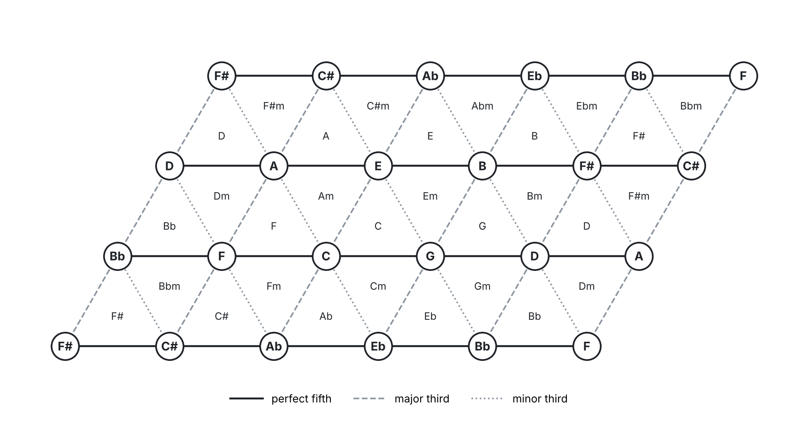
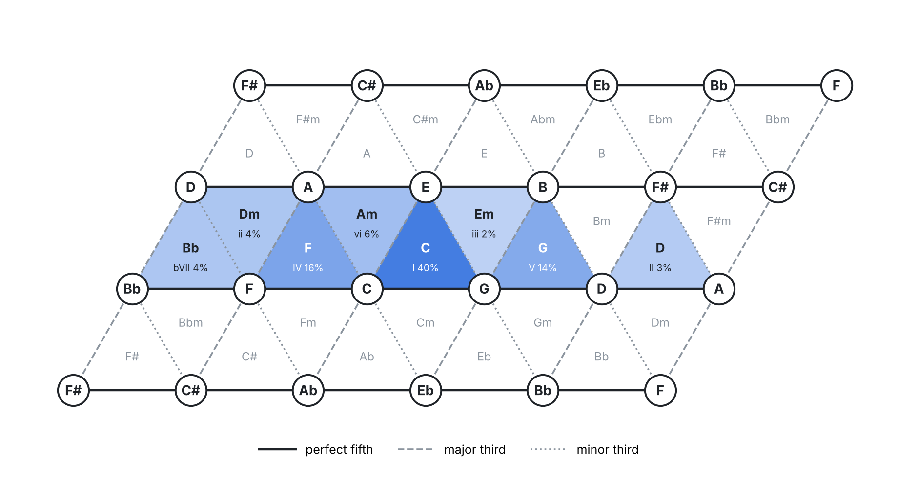

# Modeling Harmonic Space with Euler's Tonnetz
 
A graph model of tonal harmony, tested on the chord progressions of 180 Beatles songs.
 
The Tonnetz ("tone network") is a lattice of notes that Leonhard Euler introduced in 1739.
Notes a fifth or a third apart are joined, and every triangle in the lattice is a major or
minor chord. This project builds the Tonnetz as a graph, then measures how far real songs
move across it from one chord to the next.
 

 
## Results so far
 
- 66% of Beatles chord changes are one or two steps apart on the chord graph, against 39%
  for random pairs of chords. Mean distance is 2.41 steps against 2.78.
- Most of that closeness comes from which chords a song uses. With each song's chords
  shuffled, 61% of changes are still within two steps.
- The 8 most used chords (89% of playing time in major keys) form one connected block of
  triangles. Only 0.6% of random sets of 8 chords are as close together.
- Songs vary widely: *Eleanor Rigby* averages 1.18 steps per change, *Tomorrow Never Knows* 4.00.

 
## The three graphs
 
| Graph | Nodes | Edges | Built in |
| --- | --- | --- | --- |
| G1, pitch-class Tonnetz | 12 pitch classes | 36, labelled fifth, major third or minor third | `tonnetz.py` |
| G2, chord graph | 24 major and minor triads | 36, labelled P, L or R; two chords are joined when they share two notes | `tonnetz.py` |
| G3, progression graph | the same 24 triads | directed and weighted; one edge per observed chord change, weight = how often it happens | `beatles.py` |
 
The distance between two chords is the shortest path between them in G2.
 
## Files
 
| File | What it does |
| --- | --- |
| `tonnetz.py` | Builds G1 and G2 and runs the graph checks: shortest paths, diameter, cycles, Hamiltonian cycles |
| `beatles.py` | Loads the chord and key files, reduces chords to triads, builds G3, measures every chord change, runs the baselines |
| `figures.py` | Draws the two figures above |
| `play_chords.py` | Turns one chord file into a WAV file so the progression can be heard |
| `demo_data.py` | Prepares six songs for the demo page |
| `tonnetz_chord_walk.html` | Interactive demo: plays a song's chords and lights the current chord on the Tonnetz |
| `output/` | Results from the last run (see below) |
 
## Setup
 
Requires Python 3.9 or later.
 
```
git clone https://github.com/YOUR-USERNAME/tonnetz-harmony.git
cd tonnetz-harmony
pip install -r requirements.txt
```
 
### Get the data
 
The chord annotations are not stored in this repository. They come from the
[Isophonics reference annotations](http://isophonics.net/content/reference-annotations-beatles)
(Centre for Digital Music, Queen Mary University of London). Download and unpack them into
`data/beatles`:
 
```
mkdir -p data/beatles
curl -L -o beatles.tar.gz "https://github.com/c4dm/isophonics.net/raw/main/files/annotations/The%20Beatles%20Annotations.tar.gz"
tar -xzf beatles.tar.gz -C data/beatles
```
 
You should now have `data/beatles/chordlab` and `data/beatles/keylab`.
 
## Run
 
```
python tonnetz.py                                         # structural checks on G1 and G2
python beatles.py data/beatles output                     # build G3 and write the results
python figures.py output/results.json output              # draw the figures
python demo_data.py data/beatles output/demo_songs.json   # data for the demo page
```
 
To hear one song's chords:
 
```
python play_chords.py "data/beatles/chordlab/The Beatles/11_-_Abbey_Road/07_-_Here_Comes_The_Sun.lab" out.wav
```
 
To see the demo, open `tonnetz_chord_walk.html` in a browser. It needs no server and no data
download, because the six songs are embedded in the page.
 
## Output
 
| File | Contents |
| --- | --- |
| `results.json` | Every number reported above |
| `beatles_progression_graph.graphml` | G3, for Gephi or `networkx.read_graphml` |
| `key_relative_transitions.csv` | Chord changes in major keys as Roman numerals |
| `load_tonnetz.cypher` | Loads G1, G2 and G3 into Neo4j |
| `demo_songs.json` | Chords, notes and distances for the six demo songs |
| `fig1_tonnetz.png`, `fig2_beatles_chords.png` | The figures |
 
The shuffled baseline uses a fixed random seed, so repeated runs give the same numbers.
 
## How chords are handled
 
- Sevenths, sixths and ninths are reduced to the triad under them (`E:7` counts as E major).
- The bass note is ignored (`A/3` counts as A major).
- Suspended, augmented, diminished and single-note chords are not triads. They are counted
  (4.2% of labels) but left out of the graphs.
- Two labels in a row that reduce to the same triad count as one chord.
## Status and known limits
 
- **Neo4j:** the load script is generated but has not yet been run against a database.
- **Fifths and whole steps look far:** G2 joins chords only when they share two notes, so
  C to G is 2 steps and C to B-flat is 4, even though both sound close.
- **Minor keys:** the Roman-numeral analysis covers major-key passages only.
- **Data:** Beatles only so far. Queen, Carole King and the McGill Billboard set are planned.
## References
 
1. Cohn, R. (1997). Neo-Riemannian operations, parsimonious trichords, and their Tonnetz
   representations. *Journal of Music Theory*, 41(1), 1-66.
2. Harte, C. (2010). *Towards Automatic Extraction of Harmony Information from Music Signals*.
   PhD thesis, Queen Mary University of London.
3. [Isophonics reference annotations: The Beatles](http://isophonics.net/content/reference-annotations-beatles)
4. [The McGill Billboard Project](https://ddmal.ca/research/The_McGill_Billboard_Project_(Chord_Analysis_Dataset)/)
5. [NetworkX](https://networkx.org/)
6. [Tonnetz](https://en.wikipedia.org/wiki/Tonnetz), Wikipedia
Course project for the M.S. in Artificial Intelligence, University of Nebraska Omaha.
